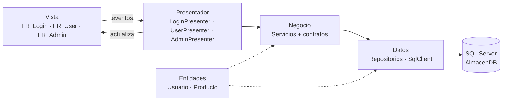

# 📦 Sistema de Almacén — Parcial Práctico (Patrón MVP)

**Universidad Tecnológica de Panamá** · Facultad de Ingeniería en Sistemas Computacionales (FISC) · Campus Víctor Levis Sasso
**Asignatura:** Herramientas de la Programación Aplicada III (.Net) · **Grupo:** 1IL133 · **II Semestre 2026**
**Instructora:** Ing. Irina Fong

Aplicación de escritorio (Windows Forms) para consultar el inventario de un almacén, con inicio de sesión seguro, menú lateral, hora en tiempo real y arquitectura en capas con el patrón **MVP**.

---

## 👤 Detalle del autor

| | |
|---|---|
| **Autor** | Tomás Vezga |
| **Cédula** | E - 8 - 217973 |
| **Correo** | tomas.vezga@utp.ac.pa |
| **Grupo** | 1IL133 |
| **Fecha de entrega** | 8 de noviembre de 2026 |

---

## 🖼️ Resultados

> Las capturas se guardan en `docs/img/` (ver nombres sugeridos en cada sección).

### Menú lateral, hora y usuario en sesión

El menú lateral queda a la izquierda; en la **parte inferior** se muestra *quién inició sesión* y la **hora actual** (se actualiza cada segundo).

| Página Administrador | Página Usuario |
|---|---|
|  |  |
|  |  |

### Inicio de sesión


### Validaciones

| Caso | Resultado esperado | Captura |
|---|---|---|
| Usuario vacío | "Escriba su nombre de usuario." |  |
| Contraseña vacía | "Escriba su contraseña." |  |
| Credenciales incorrectas | "Usuario o contraseña incorrectos." (mismo mensaje si el usuario no existe, para no revelar datos) |  |
| Cambio de contraseña: no coinciden / < 8 caracteres / sin letras y números | Mensaje con la regla incumplida |  |
| SQL Server apagado o mal configurado | "No fue posible conectar con la base de datos…" |  |

---

## 🧱 Arquitectura (MVP + capas)



| Capa | Carpeta | Responsabilidad |
|---|---|---|
| **Entidades** | `Entidades/` | Clases puras: `Usuario`, `Producto`. |
| **Datos** | `Datos/` | Conexión a SQL Server y repositorios. **Solo** ejecuta procedimientos almacenados con parámetros. |
| **Negocio** | `Negocio/` | Reglas de negocio, **contratos de hash** y servicios. |
| **Presentador** | `Presentadores/` | Intermediario: recibe eventos de la Vista, llama a Negocio y actualiza la Vista. |
| **Vista** | `Vistas/` (interfaces) y formularios (`Form1.cs`, `FR_User.cs`, `FR_Admin.cs`) | Solo muestra controles. No conoce hashes ni la base de datos. |

`Composicion.cs` es la "raíz de composición": el único lugar donde se eligen las implementaciones concretas.

### Los dos contratos independientes (capa de Negocio)

```csharp
public interface IHashService            { string GenerarHash(string textoPlano); }
public interface IVerificarHashService   { bool Verificar(string textoPlano, string hashAlmacenado); }
```

* `IHashService` → **única** responsabilidad: **generar** el hash (cambio de contraseña).
* `IVerificarHashService` → **única** responsabilidad: **verificar** texto plano contra el hash guardado (inicio de sesión).
* `Pbkdf2PasswordService` implementa ambos con **PBKDF2-HMAC-SHA256**, 100 000 iteraciones, salt aleatorio de 16 bytes y comparación en tiempo constante. Formato guardado: `iteraciones.salt.hash` (Base64).
* `AutenticacionService` recibe **solo** `IVerificarHashService`; `UsuarioService` recibe **solo** `IHashService`.
* Para cambiar a BCrypt/Argon2 solo se reemplaza `Pbkdf2PasswordService`; Vista, Presentador y BD no cambian.

### Conexión con privilegios mínimos

La app **no usa `sa` ni `dbo`**. Se conecta con el login `almacen_app`, que:

* ✅ Solo puede `EXECUTE` los 5 procedimientos almacenados de la aplicación.
* ⛔ Tiene `DENY` de `SELECT/INSERT/UPDATE/DELETE/ALTER/REFERENCES` sobre el esquema `dbo`.
* ⛔ No puede crear, modificar ni borrar objetos.

La cadena de conexión está en `App.config` (`AlmacenDB`).

---

## ⚙️ Procesos de instalación

### Requisitos previos

* Windows 10/11 con **.NET Framework 4.8**.
* **Visual Studio** con la carga de trabajo *Desarrollo de escritorio con .NET*.
* **SQL Server** (Express es suficiente) y **SQL Server Management Studio (SSMS)**.
* SQL Server con **autenticación mixta** (*SQL Server and Windows Authentication mode*):
  SSMS → clic derecho al servidor → *Properties* → *Security* → marcar la opción → reiniciar el servicio de SQL Server.

### Pasos

1. **Clonar** el repositorio.
   ```bash
   git clone <URL-DEL-REPOSITORIO>
   ```
2. **Crear la base de datos.** Abrir `Database/AlmacenDB.sql` en SSMS, conectarse como administrador y presionar **F5**.
   El script crea `AlmacenDB`, tablas, datos de ejemplo, procedimientos almacenados y el login `almacen_app`. Es re-ejecutable.
3. **Ajustar `App.config`** → `Data Source` según su instancia:

   | Instancia | Valor |
   |---|---|
   | SQL Express | `.\SQLEXPRESS` *(valor por defecto)* |
   | Instancia predeterminada | `localhost` o `.` |
   | LocalDB | `(localdb)\MSSQLLocalDB` |

4. Abrir `Parcial_2/Parcial_2.slnx` en Visual Studio y presionar **F5**.

### Usuarios de prueba

| Usuario | Contraseña | Rol |
|---|---|---|
| `admin` | `Admin123*` | Admin (ve Productos y Usuarios) |
| `jperez` | `Usuario123*` | Usuario (ve Productos y su perfil) |
| `mgomez` | `Usuario123*` | Usuario |

### Problemas frecuentes

| Mensaje / síntoma | Solución |
|---|---|
| *Login failed for user 'almacen_app'* | Habilitar autenticación mixta y reiniciar SQL Server; volver a ejecutar el script. |
| *No fue posible conectar con la base de datos* | Revisar `Data Source`; que el servicio **SQL Server (…)** esté iniciado; que **SQL Server Browser** esté activo si usa instancia con nombre. |
| *The EXECUTE permission was denied* | Volver a ejecutar la sección 5 del script (permisos). |

---

## 🗂️ Estructura del proyecto

```
.
├── README.md
├── .gitignore
├── Database/
│   └── AlmacenDB.sql            ← Script completo para SSMS
├── docs/img/                    ← Capturas del README
└── Parcial_2/
    ├── App.config               ← Cadena de conexión (usuario de mínimos privilegios)
    ├── Program.cs               ← Punto de entrada (abre FR_Login)
    ├── Composicion.cs           ← Raíz de composición
    ├── Form1.cs                 ← FR_Login (Vista)
    ├── FR_User.cs               ← Vista usuario (menú lateral)
    ├── FR_Admin.cs              ← Vista administrador (menú lateral)
    ├── Entidades/               ← Usuario, Producto
    ├── Datos/                   ← ConexionBD, repositorios (interfaces + SQL Server)
    ├── Negocio/                 ← IHashService, IVerificarHashService, servicios
    ├── Presentadores/           ← LoginPresenter, UserPresenter, AdminPresenter
    └── Vistas/                  ← ILoginView, IUserView, IAdminView, GridHelper
```

---

## 🧰 Controles utilizados

| Control | Uso |
|---|---|
| `Form` | `FR_Login`, `FR_User`, `FR_Admin` |
| `Panel` | Menú lateral (`panel1`) y paneles de contenido (`PN_Inicio`, `PN_User`, `PN_Cambio`) |
| `Button` | Navegación del menú (con `ImageList`), iniciar sesión, buscar, cambiar/actualizar contraseña |
| `Label` | Título, nombre del usuario en sesión, hora actual |
| `TextBox` | Usuario, contraseña (`UseSystemPasswordChar`), buscador, nueva contraseña y confirmación |
| `CheckBox` | "Mostrar contraseña" |
| `DataGridView` | Listado de productos (resalta en rojo el stock ≤ mínimo) y de usuarios |
| `ImageList` | Iconos del menú lateral |
| `Timer` | Reloj de la hora actual (1 s) |
| `MessageBox` | Mensajes de validación y de error |

---

## 🛠️ Tecnologías y versiones

| Tecnología | Versión |
|---|---|
| Lenguaje | C# 7.3 |
| Plataforma | .NET Framework **4.8** |
| Interfaz | Windows Forms |
| Acceso a datos | ADO.NET — `System.Data.SqlClient` (incluido en .NET Framework, sin paquetes NuGet) |
| Seguridad | PBKDF2-HMAC-SHA256 (`Rfc2898DeriveBytes`), 100 000 iteraciones |
| Base de datos | SQL Server — **[COMPLETAR: versión instalada, p. ej. 2019/2022]** (el script requiere 2016 SP1 o superior) |
| Administración de BD | SQL Server Management Studio — **[COMPLETAR: versión]** |
| IDE | Visual Studio — **[COMPLETAR: versión, p. ej. 2026]** |
| Control de versiones | Git / GitHub |

---

## 📝 Documentación del código

Todas las clases, interfaces y miembros públicos están documentados con comentarios XML (`/// <summary>`), visibles con IntelliSense.

---

*Autor: **[COMPLETAR: Nombre]** — 8 de noviembre de 2026 — Universidad Tecnológica de Panamá*
